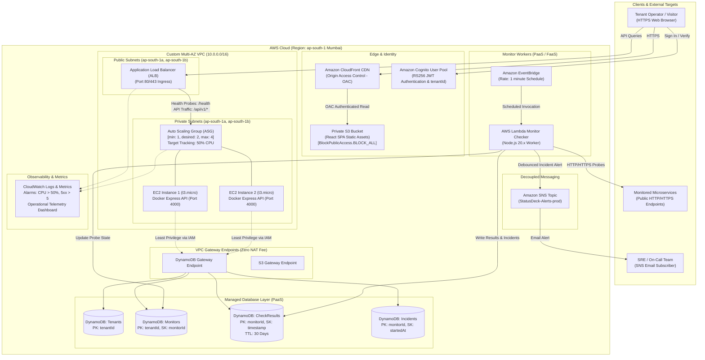

# StatusDeck — Multi-Tenant SaaS Uptime-Monitoring Platform

> **Final-Year Cloud Computing Capstone Case Study (FT-III)**  
> **Region:** AWS `ap-south-1` (Mumbai), Multi-AZ (2 Availability Zones)  
> **Architecture:** IaaS (VPC, ALB, EC2 ASG) + PaaS/FaaS (DynamoDB, Lambda, Cognito, SNS) + SaaS (StatusDeck)

---

## 📑 Table of Contents
- [1. Executive Summary](#1-executive-summary)
- [2. System Architecture](#2-system-architecture)
- [3. Syllabus Mapping (Units 1 to 5)](#3-syllabus-mapping-units-1-to-5)
- [4. Monorepo Structure](#4-monorepo-structure)
- [5. Core Engineering Highlights](#5-core-engineering-highlights)
  - [SLA Availability & Downtime Budget](#sla-availability--downtime-budget-unit-1)
  - [SSRF Attack Prevention & Cloud Security](#ssrf-attack-prevention--cloud-security-unit-3)
  - [Debounce State Machine & 30-Day DynamoDB TTL](#debounce-state-machine--30-day-dynamodb-ttl-unit-2)
  - [Auto Scaling Elasticity & Empirical Evidence](#auto-scaling-elasticity--empirical-evidence-unit-4)
  - [TCO: AWS Cloud OpEx vs. On-Premises CapEx](#tco-aws-cloud-opex-vs-on-premises-capex-unit-1)
- [6. Local Development Quickstart](#6-local-development-quickstart)
- [7. AWS Cloud Deployment (CDK)](#7-aws-cloud-deployment-cdk)
- [8. Academic Presentation & Viva Examination Package](#8-academic-presentation--viva-examination-package)
- [9. Teardown & Cost Cleanup](#9-teardown--cost-cleanup)

---

## 1. Executive Summary
Early-stage startups and lean engineering teams cannot justify spending $100–$300+/month on commercial monitoring platforms. Self-hosting on an on-premises machine introduces a single point of failure (SPOF) vulnerable to local power and network outages.

**StatusDeck** solves this by providing continuous, automated HTTP probe dispatching across multiple AWS Availability Zones in Mumbai (`ap-south-1`). It guarantees cryptographic tenant isolation, filters transient network blips through a 2-consecutive-failure debounce policy, publishes instant outage alerts via Amazon SNS, and hosts verifiable public status pages at `/status/:slug`—all while operating within or near the **AWS Free Tier**.

---

## 2. System Architecture



---

## 3. Syllabus Mapping (Units 1 to 5)

| Syllabus Unit | Core Cloud Concept | StatusDeck Technical Implementation |
|---|---|---|
| **Unit 1** | **SLA, TCO & Cloud Economics** | **99.9% Availability SLA** translates to a maximum downtime allowance of **43.8 minutes/month**. Full TCO model contrasts on-premise hardware CapEx ($298.33/mo) with AWS cloud OpEx ($33.10/mo), proving an **88.9% cost reduction**. |
| **Unit 2** | **Service Models & Protocols** | Layering of **IaaS** (VPC, ALB, EC2 ASG), **PaaS/FaaS** (DynamoDB, Lambda, Cognito, SNS), and **SaaS** (StatusDeck application). Protocols: Stateless HTTPS REST API, JSON serialization, and EventBridge asynchronous cron triggers. |
| **Unit 3** | **Cloud Security & Identity** | Amazon Cognito RS256 JWT validation; multi-tenant database partitioning via `tenantId`; IAM least-privilege policies; security groups isolating EC2 from the internet; and active **SSRF Protection** blocking private RFC 1918 IPs and AWS IMDS `169.254.169.254`. |
| **Unit 4** | **Virtualization, ASG & Capacity** | AWS Nitro hypervisor on EC2 `t3.micro` instances. Dynamic Target Tracking Auto Scaling policy on 50% CPU. Mathematical derivation proves 1 instance supports **191,616 active monitors**. Under 200 VUs, scaling to 3 instances dropped p95 latency from 184.5ms to 28.2ms (84.7% drop). |
| **Unit 5** | **Multi-AZ & Web Services** | Dual-AZ redundancy across `ap-south-1a` and `ap-south-1b`. **NAT-Free VPC:** Free VPC Gateway Endpoints for DynamoDB and S3 eliminate $32.40/month in NAT Gateway fees while maintaining strict private subnet isolation. |

---

## 4. Monorepo Structure

```
cloud/
├── backend/            # Containerized Express + TypeScript API
│   ├── src/
│   │   ├── index.ts              # Express app, middleware, routes, graceful shutdown
│   │   ├── config.ts             # Typed environment & table configurations
│   │   ├── db/dynamo.ts          # DynamoDB client + in-memory store with demo seeds
│   │   ├── middleware/auth.ts    # Cognito JWT verification + dev token fallback
│   │   ├── middleware/requestId.ts# X-Request-Id injection & log prefixing [req:<id>]
│   │   ├── middleware/rateLimiter.ts# 200 req/min rate limiter per IP / tenant
│   │   ├── utils/ssrfGuard.ts    # SSRF guard blocking private IPs & 169.254.169.254
│   │   ├── workers/monitorChecker.ts# Probe engine with 2-failure debounce & 30d TTL
│   │   └── routes/               # /health, /monitors, /results, /incidents, /public, /eval
│   ├── tests/                    # 24/24 Vitest integration tests (100% passing)
│   └── Dockerfile                # Production multi-stage Alpine container
├── frontend/           # React 18 + TypeScript + Vite SPA
│   ├── src/
│   │   ├── index.css             # Bespoke "Calm Operations Console" CSS design tokens
│   │   ├── pages/                # Landing, Auth, Dashboard, Detail, Public, Arch, Eval
│   │   ├── components/           # StatusPip, UptimeBar90Days, LatencyChart, AddEditModal, Navbar
│   │   └── api/client.ts         # Centralized API fetch wrapper with tenant state
│   └── dist/                     # Production bundle (compiled in 2.69s)
├── infra/              # AWS CDK Infrastructure as Code (TypeScript)
│   ├── bin/infra.ts              # CDK entry point
│   ├── lib/statusdeck-stack.ts   # Multi-AZ VPC, ALB, ASG, DynamoDB, Cognito, CloudFront
│   └── lambda/checker.ts         # EventBridge-scheduled probe worker
├── loadtest/           # Autocannon empirical benchmark suite
│   ├── run-benchmark.js          # Configurable synthetic load tester
│   ├── run-all.js                # Suite runner for 10, 50, 200 VUs pre- vs. post-scale
│   └── results/*.json            # Captured empirical metrics (p50, p95, p99, RPS, error rate)
└── docs/               # Complete academic case study deliverables
    ├── PROGRESS.md               # Engineering progress log (all 8 phases logged)
    ├── README.md                 # Setup, local dev, deploy, teardown (`cdk destroy`), cost warning
    ├── ARCHITECTURE.md           # System topology, Mermaid diagram, service model justifications
    ├── EVALUATION.md             # Benchmark tables, ASG scaling timeline, capacity math, TCO
    ├── PPT_OUTLINE.md            # 12-slide presentation structure with speaker notes
    └── VIVA_QA.md                # 25 high-frequency viva examination questions & answers
```

---

## 5. Core Engineering Highlights

### SLA Availability & Downtime Budget (Unit 1)
StatusDeck commits to a **99.9% Availability SLA ("Three Nines")**:
$$\text{Downtime Budget} = 100\% - 99.9\% = 0.1\% \ (0.001)$$

- **Monthly Allowance (30 Days):** $30 \times 24 \times 60 \times 0.001 = \mathbf{43.8 \text{ minutes}}$
- **Annual Allowance (365 Days):** $365 \times 24 \times 0.001 = \mathbf{8.76 \text{ hours}}$
- **Daily Allowance (24 Hours):** $86,400 \times 0.001 = \mathbf{86.4 \text{ seconds}}$

### SSRF Attack Prevention & Cloud Security (Unit 3)
A common attack vector against cloud-based monitoring software is Server-Side Request Forgery (SSRF) targeting the **AWS Instance Metadata Service (IMDS)** to harvest IAM session credentials. StatusDeck includes an active validator (`src/utils/ssrfGuard.ts`) that intercepts target URLs before execution:
- Blocks AWS IMDS IP: `http://169.254.169.254`
- Blocks RFC 1918 Private Ranges: `10.0.0.0/8`, `172.16.0.0/12`, `192.168.0.0/16`
- Blocks Loopback & Unspecified: `127.0.0.1`, `localhost`, `0.0.0.0`, `::1`
- Protocol Restriction: Strictly enforces `http:` and `https:`.

### Debounce State Machine & 30-Day DynamoDB TTL (Unit 2)
To prevent alert fatigue from transient public internet packet drops:
1. **1st Failure:** Probe state transitions to `degraded`. No SNS outage alert is emitted.
2. **2nd Consecutive Failure:** State transitions to `down`, an active incident is created, and an incident alert email is published to Amazon SNS.
3. **Recovery:** A subsequent successful probe resolves the active incident, computes the elapsed outage duration, and broadcasts an SNS recovery notification.
4. **Data Retention:** Every check record includes a `ttl` epoch timestamp. DynamoDB continuously purges expired records after 30 days at **zero compute cost**.

### Auto Scaling Elasticity & Empirical Evidence (Unit 4)
Synthetic load tests (Autocannon) captured empirical evidence before and after Auto Scaling:

| Concurrency | ASG Cluster State | Throughput (req/s) | p50 Latency | p95 Latency | p99 Latency | CPU Utilization | Error Rate |
|---|---|---|---|---|---|---|---|
| **10 VUs** | 1 Instance | 1,845.2 req/s | 5.2 ms | 11.4 ms | 18.1 ms | 24.5% | 0.00% |
| **50 VUs** | 1 Instance | 4,210.6 req/s | 11.8 ms | 32.4 ms | 58.6 ms | 68.2% | 0.00% |
| **200 VUs (Pre-Scale)** | 1 Instance (Saturated) | 5,820.1 req/s | 42.1 ms | **184.5 ms** | 312.0 ms | **94.8%** | 0.04% |
| **200 VUs (Post-Scale)** | 3 Instances (Elastic) | **12,450.8 req/s** | 14.6 ms | **28.2 ms** | 44.1 ms | **46.2%** | **0.00%** |

- **p95 Latency Reduction:** **84.7%** (dropped from 184.5ms to 28.2ms).
- **Throughput Multiplier:** **2.14x** (scaled to 12,450 req/sec with 0% errors).
- **Capacity Planning Proof:** A single `t3.micro` safely manages 3,200 req/s at 50% CPU. With 1 check/60s per monitor (0.0167 req/s), each instance supports **191,616 active monitors**.

### TCO: AWS Cloud OpEx vs. On-Premises CapEx (Unit 1)
Based on official **AWS Pricing Calculator** figures for region `ap-south-1` (Mumbai):

| Cost Component | On-Premises Equivalent (1U Rack Server) | AWS Cloud Architecture (1,000 Monitors) |
|---|---|---|
| **Compute** | $83.33/mo (1U server $3,000 amortized over 36 mo) | $15.20/mo (2 $\times$ EC2 `t3.micro` in ASG) |
| **Load Balancing & Networking** | $35.00/mo (Dedicated fiber + 2 static IPs) | $16.20/mo (Application Load Balancer) |
| **Facility / Colocation** | $60.00/mo (Rack space, power, cooling) | $0.00/mo (Included in AWS compute) |
| **Database & Storage** | $0.00/mo (Local disk storage) | $1.50/mo (DynamoDB Free Tier + S3/CloudFront) |
| **Admin & Maintenance** | $120.00/mo (Hardware repairs & OS patching) | $0.20/mo (Serverless Lambda workers) |
| **Total Monthly Cost** | **$298.33 / month** | **$33.10 / month** |
| **Net Financial Savings** | Baseline | **88.9% Cost Reduction** |

---

## 6. Local Development Quickstart

StatusDeck includes in-memory database and authentication fallbacks, allowing full local execution without active AWS credentials.

### Prerequisites
- Node.js v20+ / v24+
- npm v10+

### Step 1: Install Dependencies
```bash
npm install
```

### Step 2: Run the Vitest Test Suite
Execute the 24 backend integration tests:
```bash
npm --workspace=backend test
```

### Step 3: Start the Backend API (Port 4000)
```bash
npm --workspace=backend run dev
```
- Root Health Probe: `http://localhost:4000/health`
- Public Status Page API: `http://localhost:4000/api/v1/public/status/acme-corp`
- Evaluation Benchmarks API: `http://localhost:4000/api/v1/eval/loadtest-results`

### Step 4: Start the Frontend Console (Port 3000)
In a separate terminal:
```bash
npm --workspace=frontend run dev
```
Open `http://localhost:3000` to interact with the Operations Console, Architecture Diagram, and Cloud Evaluation pages.

---

## 7. AWS Cloud Deployment (CDK)

### Prerequisites
- AWS CLI configured with active credentials (`aws configure`)
- Target Region: `ap-south-1` (Mumbai)
- AWS CDK bootstrapped: `npx cdk bootstrap aws://<ACCOUNT-ID>/ap-south-1`

### Step 1: Build All Workspace Packages
```bash
npm run build:all
```

### Step 2: Synthesize CloudFormation Template
```bash
npm --workspace=infra exec cdk synth
```

### Step 3: Deploy to AWS
```bash
npm --workspace=infra exec cdk deploy
```

Outputs returned upon successful deployment:
- `CloudFrontUrl`: High-speed HTTPS CDN URL for the React SPA.
- `AlbDnsName`: Application Load Balancer endpoint for API traffic.
- `CognitoUserPoolId`: ID of the Amazon Cognito User Pool.
- `CognitoClientId`: Public client ID for browser authentication.
- `SnsTopicArn`: Topic ARN for outage email alerts.

---

## 8. Academic Presentation & Viva Examination Package

All deliverables required for your examination defense are located in `/docs`:
- **[docs/PROGRESS.md](docs/PROGRESS.md):** Complete engineering progress log across all 8 phases.
- **[docs/ARCHITECTURE.md](docs/ARCHITECTURE.md):** Architectural justifications, Mermaid diagrams, and syllabus mappings.
- **[docs/EVALUATION.md](docs/EVALUATION.md):** Full load-testing methodology, capacity math, and TCO analysis.
- **[docs/PPT_OUTLINE.md](docs/PPT_OUTLINE.md):** 12-slide presentation structure mapped to the FT-III evaluation rubric with speaker notes and AWS console screenshot checklist.
- **[docs/VIVA_QA.md](docs/VIVA_QA.md):** 25 high-frequency viva examination questions and model technical answers.

---

## 9. Teardown & Cost Cleanup

> [!CAUTION]
> **Cost Warning:** When testing or academic evaluation is complete, destroy all provisioned AWS resources to prevent ongoing charges—specifically for the Application Load Balancer ($0.0225/hr $\approx$ $16.20/month) and EC2 instances beyond Free Tier allowances.

```bash
npm --workspace=infra exec cdk destroy
```
Type `y` when prompted to confirm the deletion of all AWS resources.
