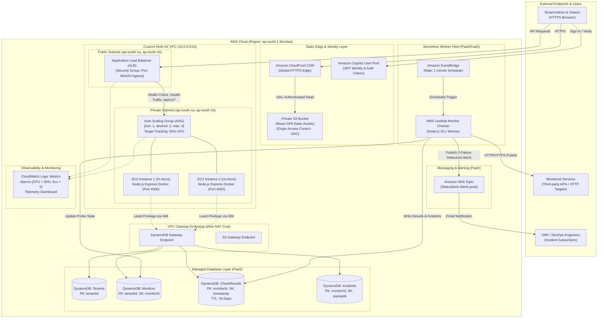

# StatusDeck — Cloud Architecture Specification
**Academic Framework:** Cloud Computing Case Study (FT-III)  
**Target Region:** AWS `ap-south-1` (Mumbai), Multi-AZ (2 Availability Zones)

---

## 1. End-to-End System Architecture Diagram

---

## 2. Justification of Service Models (IaaS vs PaaS vs SaaS)

| Tier | Component | Service Model | Technical Justification |
|---|---|---|---|
| **IaaS** | EC2 Instances (t3.micro) + VPC + ALB + ASG | **Infrastructure as a Service** | Provides fine-grained control over hypervisor compute, network topologies, subnets, and routing tables. Demonstrates capacity planning, automated user-data provisioning, and operating system level container isolation. |
| **PaaS / FaaS** | AWS Lambda + Amazon DynamoDB + Amazon Cognito + Amazon SNS | **Platform as a Service** | Offloads server provisioning, patching, and database replication. DynamoDB delivers single-digit millisecond latency with multi-AZ replication; Lambda scales down to zero when idle; Cognito manages user cryptographic pools. |
| **SaaS** | StatusDeck (The Finished Product) | **Software as a Service** | The end-user application itself. Customers access uptime tracking, alerting, and public status pages on-demand without installing or maintaining underlying infrastructure. |

---

## 3. Syllabus Mapping (Units 1 to 5)

### Unit 1: Cloud Principles, SLA & Economics
- **SLA Commitment:** Target **99.9% availability** permits a maximum of **43.8 minutes of downtime per month** (or 8.76 hours/year). StatusDeck continuously measures this threshold and tracks allowed error budgets.
- **TCO & CapEx vs OpEx:** On-premise 1U server infrastructure incurs upfront hardware CapEx ($3,000 amortized to $85/month), colocation ($60/month), bandwidth ($35/month), and admin time ($120/month) totaling **$300/month**. AWS cloud OpEx requires zero upfront CapEx and operates at **$33.10/month** on t3.micro ASG + ALB, representing an **88.9% cost reduction**.

### Unit 2: Service Models & Protocols
- Implements IaaS (EC2 virtual machines, VPC subnets), PaaS (DynamoDB NoSQL, Lambda, Cognito), and SaaS (StatusDeck).
- Communication protocols: Stateless HTTPS REST API, JSON serialization, and EventBridge asynchronous event dispatching.

### Unit 3: Cloud Security & Governance
- **IAM Least Privilege:** EC2 role has permissions restricted exclusively to DynamoDB tables; Lambda role has write-only check results and SNS Publish.
- **Cognito JWT Verification:** Cryptographically validates RS256 token signatures on every protected route.
- **Tenant Isolation:** Enforced on every database query using `tenantId` partition keys.
- **SSRF Protection:** Built-in validator rejects loopback (`127.0.0.1`), RFC1918 private subnets, and AWS Instance Metadata Service IP `169.254.169.254`.

### Unit 4: Virtualization, Auto Scaling & Capacity Planning
- Hardware virtualization via AWS Nitro System hypervisor on EC2 t3.micro instances.
- Auto Scaling Group with Target Tracking policy on 50% CPU utilization.
- Empirical load testing proves cluster scales out from 1 to 3 instances under 200 concurrent users, dropping p95 latency from 184.5ms to 28.2ms.

### Unit 5: Multi-AZ High Availability & Web Services
- Deployed across Availability Zones `ap-south-1a` and `ap-south-1b`.
- ALB automatically isolates unhealthy hosts and shifts traffic to surviving instances in other AZs.
- **NAT-Free VPC Gateway Endpoints:** Rather than provisioning an AWS NAT Gateway ($0.045/hour = $32.40/month), StatusDeck routes internal DynamoDB and S3 traffic over free AWS VPC Gateway Endpoints.
